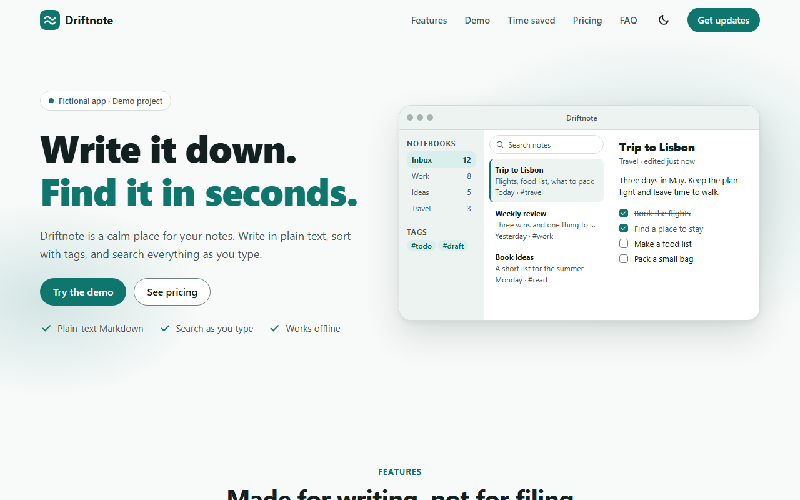
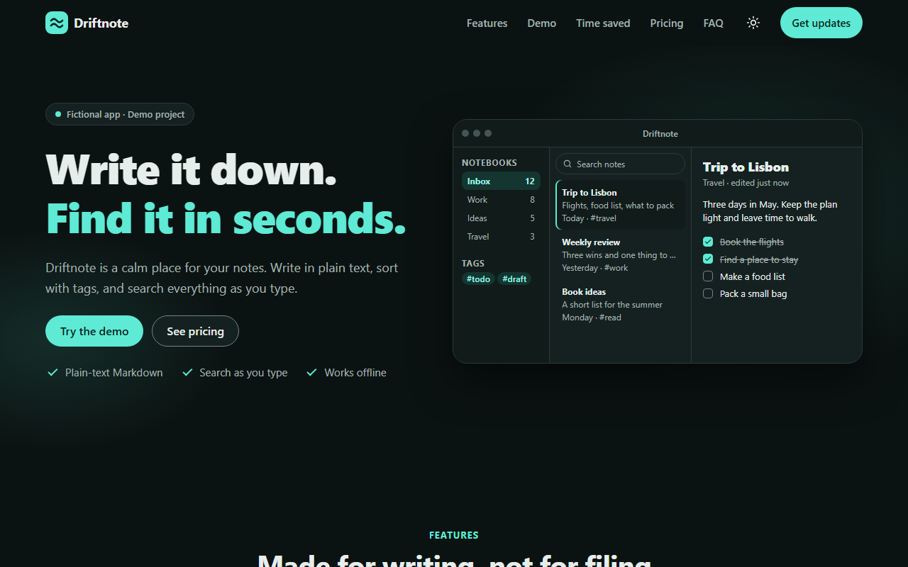

# Driftnote — landing page

A landing page for **Driftnote**, a fictional note-taking app.
Built with only HTML, CSS and vanilla JavaScript: no framework, no UI library and no build step.



**Live demo:** https://driftnote-landing.vercel.app

> Fictional product. Demo project. There are no fake testimonials, no fake company
> logos and no fake user numbers. No data is sent anywhere.

## What it is

A complete, responsive landing page that I can explain file by file.
Every CSS and JavaScript file is short and has one job.
The page has nine sections, a privacy page and a 404 page.

## Features

- **Sticky header** with a logo drawn in SVG, navigation, a dark mode button and a mobile menu.
  The header gets a shadow after scrolling, and the active link follows the section you are reading.
- **Hero** with an app mockup drawn only with HTML and CSS.
- **Six feature cards** in a responsive grid, with SVG icons.
- **Interactive demo** with tabs (Write, Organize, Search). Arrow keys, Home and End work,
  and the ARIA roles are `tablist`, `tab` and `tabpanel`.
- **"Time saved" calculator** with two sliders. The math is a pure function in `js/calculator.js`.
- **Pricing** with a Monthly / Yearly switch (yearly = 2 months free).
  All prices come from one data object in `js/pricing.js`.
- **FAQ accordion** with `aria-expanded`, one answer open at a time.
- **Newsletter form** with validation in the browser and a success message.
  The email is **not** sent and **not** stored.
- **Scroll reveal** animations and a **back to top** button.
- **Dark mode** that remembers your choice and never flashes the wrong theme.
- Respects `prefers-reduced-motion`.



## Tech

| Part | What I used |
|------|-------------|
| Structure | Semantic HTML |
| Style | CSS variables, grid, flexbox, `clamp()`, container queries. System fonts. |
| Behavior | JavaScript ES modules, one file per feature. `IntersectionObserver`. |
| Tests | Vitest, only for the two files with pure functions |
| Hosting | Vercel (static files) |

There is no build step. The browser loads the files exactly as they are in this repository.

## How to run

The site needs a static server (JavaScript modules do not load from `file://`).
Pick one of these in the project folder:

```bash
npx serve
```

```bash
python -m http.server 8000
```

Then open the address that the command prints.

Tip: these simple servers let the browser keep old copies of files. If you edit a file
and nothing changes, do a hard reload (Ctrl+Shift+R, or Cmd+Shift+R on a Mac).

### Tests

```bash
npm install
```

```bash
npm test
```

`package.json` is only for the tests. The site itself needs no install.

### Deploy

The site is hosted on Vercel as plain static files: Vercel does not build anything.
`.vercelignore` keeps the tests, the docs and the npm files off the live site.

The GitHub repository is **not** connected to Vercel (the connection failed when I set it up),
so a push to GitHub does not update the live site. To deploy, run this in the project folder:

```bash
npx vercel --prod
```

## Folder structure

```
index.html            the landing page (all nine sections)
privacy.html          the privacy page
404.html              the "page not found" page
icons.svg             the logo and every icon in one file (SVG sprite)
favicon.svg / .ico    the browser tab icon
og-image.png          the preview image for shared links (1200 x 630)
css/
  base/               tokens (variables), reset, typography, accessibility
  layout/             page grid, header, hero, footer, simple pages
  components/         buttons, cards, mockup, tabs, calculator, pricing, faq, form, scroll
js/
  theme-init.js       sets light or dark mode before the page is drawn
  main.js             starts every feature of the landing page
  simple-page.js      starts the theme button on the two small pages
  calculator.js       pure math (tested)
  pricing.js          price data + pure math (tested)
  *-ui.js, others     one small file per feature
tests/                Vitest tests for calculator.js and pricing.js
docs/
  PLAN.md             the plan I wrote before coding
  HOW_IT_WORKS.md     every file explained, how to rebuild it, interview questions
```

## Quality checks

Measured on 2026-11-10. Lighthouse ran on the live site. The axe-core, keyboard and layout
checks ran locally and again on the live site, with the same results.

| Check | Result |
|-------|--------|
| Unit tests (Vitest) | 34 of 34 pass |
| Lighthouse 13.6, home page, mobile | Performance 73, 100, 93 and 100 in four runs · Accessibility 100 · Best Practices 100 · SEO 100 |
| Lighthouse 13.6, home page, desktop | Performance 97 · Accessibility 100 · Best Practices 100 · SEO 100 |
| Lighthouse 13.6, privacy page, mobile | Performance 100 · Accessibility 100 · Best Practices 100 · SEO 100 |
| axe-core 4.14 | 0 violations in 22 audits (light and dark, 360 and 1280 px, open menu, tabs, form errors) |
| Keyboard only | All 34 Tab stops can be reached and show a focus ring |
| Layout | No sideways scrolling at 360, 768 and 1280 px, in light and dark mode |

Why the mobile Performance score changes: Lighthouse measures how long the work takes on the
test computer and multiplies it to simulate a slow phone. When that computer is busy, the work
takes longer and the score drops. The run that gave 73 had a CPU benchmark of 1508; the runs
that gave 100 had about 2150.

## What I learned

- **CSS variables make dark mode simple.** The same names get new values under
  `[data-theme="dark"]`. A tiny script in `<head>` has to set the theme before the first
  paint, or dark mode users see a white flash.
- **Keep math away from the page.** `calculator.js` and `pricing.js` never touch the DOM,
  so I could test them with Vitest in a few lines.
- **ARIA is state, not decoration.** `aria-expanded`, `aria-selected` and `aria-current`
  describe what is true right now. My CSS reads the same attributes, so the look and the
  screen reader can never disagree.
- **Native elements do a lot for free.** The billing switch is two radio buttons and the
  sliders are `<input type="range">`. Keyboard support came with them.
- **`IntersectionObserver` beats scroll math.** The browser tells me when a section enters
  the screen. I use it for the active nav link and for the reveal animation.
- **File order matters in CSS.** My menu button stayed visible on desktop because a rule in
  a later file had the same strength. I fixed it with a more specific selector.
- **A 404 page needs absolute paths.** It can be shown for any address, so `css/...` would
  break and `/css/...` works.
- **Content first.** The FAQ answers are open in the HTML and JavaScript closes them, so the
  page is still readable if a script fails.

More details are in [docs/HOW_IT_WORKS.md](docs/HOW_IT_WORKS.md).
